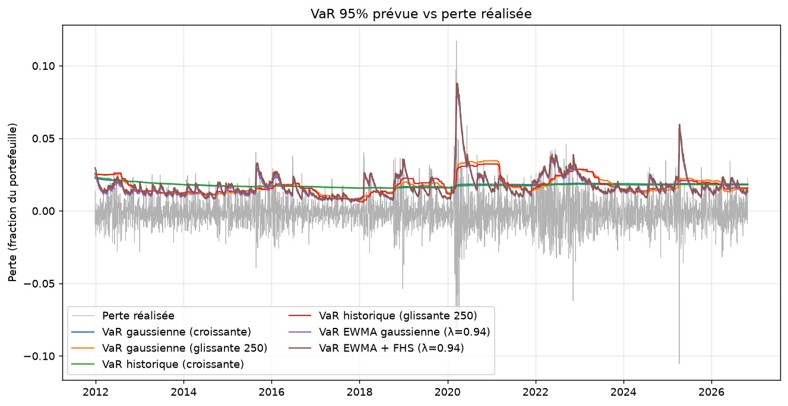
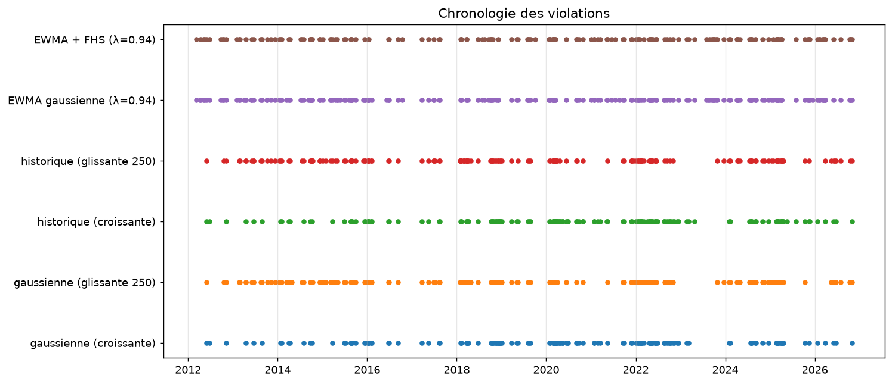
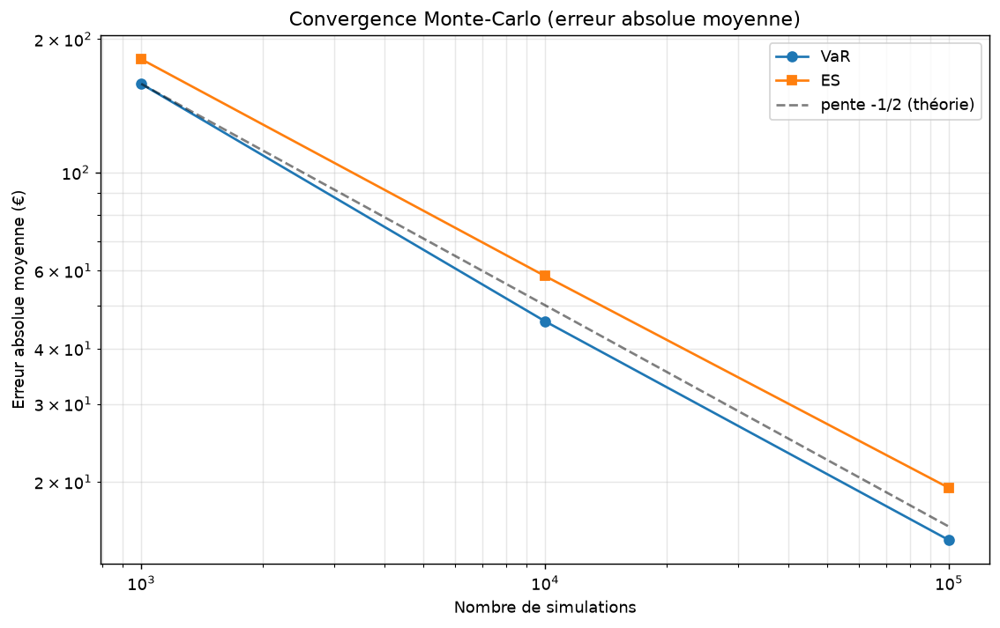

# VaR et Expected Shortfall : Monte-Carlo, historique, gaussien et backtesting

Projet personnel (M1 mathématiques appliquées, Paris-Saclay) : estimation et validation de la
Value at Risk (VaR) et de l'Expected Shortfall (ES) d'un portefeuille de trois ETF
(SPY 50 %, QQQ 30 %, IWM 20 %).


## Ce que fait le projet

1. **Théorie** : VaR comme quantile des pertes, ES comme perte moyenne au-delà de la VaR.
2. **Monte-Carlo** : simulation de rendements gaussiens multivariés (et Student pour les queues
   épaisses), comparaison à la formule fermée, étude de convergence (erreur moyennée sur
   plusieurs répétitions, pente théorique en $\frac{1}{\sqrt N}$).
3. **VaR historique** sur 3 ETF, avec dates fixes et données en cache (résultats reproductibles).
4. **Backtesting hors échantillon sur le portefeuille** (sans look-ahead) : fenêtre croissante vs
   fenêtre glissante, méthode gaussienne vs historique, tests de Kupiec (couverture),
   Christoffersen (indépendance), couverture conditionnelle, EWMA (RiskMetrics) et Filtered Historical Simulation.

## Structure

```
var-es-risk-engine/
├── var_es/               # le code réutilisable
│   ├── data.py           # téléchargement (dates fixes + cache CSV), rendements, données fictives
│   ├── portfolio.py      # poids indexés par ticker, rendements/pertes du portefeuille
│   ├── models.py         # VaR/ES : empirique, gaussienne (formules fermées), Monte-Carlo
│   ├── convergence.py    # erreur Monte-Carlo moyennée sur répétitions
│   ├── backtest.py       # prévisions glissantes, violations, Kupiec, Christoffersen, Bâle
│   ├── ewma.py           # volatilité EWMA (RiskMetrics), VaR/ES gaussienne et FHS
│   ├── comparison.py     # compare_models : backtest des six modèles sur les mêmes dates
│   └── plots.py          # graphiques
├── scripts/              # points d'entrée
│   ├── run_mc_convergence.py
│   └── run_backtest.py
├── notebooks/VaR_ES.ipynb  # présentation des résultats et analyse théorique
├── tests/                # tests unitaires (pytest)
├── data/                 # prix téléchargés (ignorés par git)
└── results/              # tableaux et figures générés
```

## Installation et utilisation

Création et activation de l'environnement virtuel :

```bash
# Linux / macOS
python -m venv .venv
source .venv/bin/activate
```

```powershell
# Windows (PowerShell)
python -m venv .venv
.venv\Scripts\Activate.ps1
# si l'exécution de scripts est bloquée :
# Set-ExecutionPolicy -Scope Process -ExecutionPolicy Bypass
```

Puis, dans les deux cas :

```bash
pip install -e .
pip install pytest

pytest                                   # vérifie le code (41 tests)
python -m scripts.run_mc_convergence     # convergence Monte-Carlo -> results/
python -m scripts.run_backtest           # backtest sur SPY/QQQ/IWM (nécessite Internet)
python -m scripts.run_backtest --synthetic   # même chose sur données fictives, sans connexion
```

Les données fictives (`--synthetic`) servent uniquement à tester le code : elles n'ont aucune
valeur financière.

## Méthodes

Pour une perte $L$ et un niveau $\alpha \in (0, 1)$ :

- $\text{VaR}_\alpha(L) = q_\alpha(L)$
- $\text{ES}_\alpha(L) = \frac{1}{(1 - \alpha)} \int_\alpha^1 \text{VaR}_u(L) \, du$, soit $\mathbb{E}[L \mid L \geq \text{VaR}_\alpha(L)]$ pour une loi continue
- Cas gaussien $L \sim \mathcal{N}(m, s^2)$ : $\text{VaR} = m + s \cdot \Phi^{-1}(\alpha)$ et $\text{ES} = m + s \frac{\phi(\Phi^{-1}(\alpha))}{1-\alpha}$

où $\Phi$ est la fonction de répartition de la loi normale standard et $\phi$ sa densité.

Backtesting (une violation = perte réalisée > VaR prévue la veille) :

- **Kupiec** (couverture inconditionnelle) : $LR_{uc}\sim\chi^2(1)$ sous $H_0$ (le modèle est correctement calibré en couverture inconditionnelle), la fréquence de violations est $1 − α$.
- **Christoffersen** (indépendance) : compare $\mathbb{P}(violation\,|\, veille\, sans\, violation)$ et
  $\mathbb{P}(violation\,|\, veille\, avec\, violation)$, $LR_{ind}\sim\chi^2(1)$.
- **Couverture conditionnelle** : $LR_{cc} = LR_{uc} + LR_{ind} \sim\chi^2(2)$.
- **EWMA** (RiskMetrics) : 
Variance prévue pour le jour $t$, à partir des rendements jusqu'à $t−1$ :  
$\sigma^2_t = \lambda \cdot \sigma^2_{t-1} + (1 - \lambda) \cdot r^2_{t-1}$. 
Les rendements récents pèsent davantage : le poids d'un jour est multiplié par $λ$ à chaque jour
  de recul.  
Paramètre $λ$ = 0,94, la valeur standard de RiskMetrics pour des données journalières (demi-vie
  d'environ 11 jours). Il n'est pas optimisé sur nos données.  
Rendement moyen supposé nul (convention RiskMetrics, raisonnable à un jour). La première variance est initialisée avec celle des 30 premiers rendements, puis la récursion s'applique.
- **EWMA gaussienne**: $VaR_t = σ_t · Φ⁻¹(α)$ et $ES_t = σ_t · \frac{\phi(Φ⁻¹(α))}{(1 − α)}$.
- **EWMA + FHS** (Filtered Historical Simulation) : on divise chaque perte passée par la
  volatilité prévue ce jour-là, on prend le quantile empirique (et la moyenne de la queue) de ces
  pertes standardisées, puis on les multiplie par la volatilité prévue pour demain. La volatilité
  s'adapte au régime de marché, et la forme des queues vient des données, sans hypothèse gaussienne.
- Limite : la variance EWMA ne revient pas vers une moyenne de long terme (c'est un modèle IGARCH
  sans constante), ce qui motive le GARCH(1,1).

## Résultats

### Backtest hors échantillon sur le portefeuille (SPY 50 % / QQQ 30 % / IWM 20 %)

Période de test : 3 732 jours (du 28/12/2011 au 30/10/2026). Les données couvrent 2010 à 2026 ; les 500 premiers jours servent uniquement à l’estimation initiale.
Une violation correspond à une perte réalisée supérieure à la VaR prévue la veille.

| Niveau | Modèle | Violations | Attendues | Taux | p Kupiec | p indépendance | p cond. |
|---|---|---|---|---|---|---|---|
| 95 % | Gaussienne (croissante) | 165 | 186,6 | 4,42 % | 0,098 | < 0,001 | < 0,001 |
| 95 % | Gaussienne (glissante 250) | 199 | 186,6 | 5,33 % | 0,357 | < 0,001 | < 0,001 |
| 95 % | Historique (croissante) | 175 | 186,6 | 4,69 % | 0,379 | < 0,001 | < 0,001 |
| 95 % | Historique (glissante 250) | 189 | 186,6 | 5,06 % | 0,857 | < 0,001 | < 0,001 |
| 95 % | EWMA gaussienne (λ=0,94) | 213 | 186,6 | 5,71 % | 0,052 | 0,393 | 0,105 |
| 95 % | EWMA + FHS (λ=0,94) | 181 | 186,6 | 4,85 % | 0,673 | 0,269 | 0,496 |
| 99 % | Gaussienne (croissante) | 74 | 37,3 | 1,98 % | < 0,001 | < 0,001 | < 0,001 |
| 99 % | Gaussienne (glissante 250) | 88 | 37,3 | 2,36 % | < 0,001 | < 0,001 | < 0,001 |
| 99 % | Historique (croissante) | 41 | 37,3 | 1,10 % | 0,551 | < 0,001 | 0,003 |
| 99 % | Historique (glissante 250) | 60 | 37,3 | 1,61 % | < 0,001 | < 0,001 | < 0,001 |
| 99 % | EWMA gaussienne (λ=0,94) | 85 | 37,3 | 2,28 % | < 0,001 | 0,055 | < 0,001 |
| 99 % | EWMA + FHS (λ=0,94) | 39 | 37,3 | 1,05 % | 0,784 | < 0,001 | 0,003 |

**Lecture.** À 95 %, les quatre modèles à volatilité statique ont un taux de violations proche
de 5 % mais rejettent l'indépendance : les violations arrivent par paquets. Les deux modèles
EWMA ne la rejettent pas et passent les trois tests au seuil de 5 % ; la FHS le fait plus
confortablement (Kupiec p = 0,67 contre 0,052 pour l'EWMA gaussienne, à la limite du rejet). À 99 %, les
VaR gaussiennes produisent environ deux fois trop de violations (même avec une volatilité EWMA),
ce qui traduit des queues plus épaisses que la loi normale. La FHS corrige la fréquence
(39 violations pour 37,3 attendues), comme l'historique croissant, mais les violations restent
regroupées ($p$ = 0,0006). Aucun modèle ne passe tous les tests à 99 %.





### Convergence Monte-Carlo (Matrice de covariance empirique des ETF, 100 répétitions)

Évaluation de la vitesse de convergence de l'erreur absolue moyenne sur $M = 100$ répétitions indépendantes par rapport à la formule gaussienne fermée ($\text{VaR}_{99\%} = 3\,615{,}99\text{ €}$, $\text{ES}_{99\%} = 4\,148{,}83\text{ €}$) :

| Simulations ($N$) | Erreur VaR (€) | Erreur ES (€) | Ordre de grandeur ($\propto 1/\sqrt{N}$) |
| :---: | :---: | :---: | :---: |
| **1 000** | 158,46 € | 180,14 € | Baseline |
| **10 000** | 46,09 € | 58,32 € | Erreur divisée par ~3,4 ($\sqrt{10}$) |
| **100 000** | 14,77 € | 19,38 € | Erreur divisée par ~10,7 ($\sqrt{100}$) |



**Lecture.** L'erreur diminue proportionnellement à $\frac{1}{\sqrt N}$, conformément à la théorie : pour la
diviser par 10, il faut multiplier le nombre de simulations par 100. L'erreur sur l'ES est
systématiquement supérieure à celle sur la VaR, car l'ES moyenne des pertes extrêmes, plus
bruitées. À 100 000 simulations, l'erreur sur la VaR 99 % est d'environ 0,5 % de sa valeur.

## Conclusion

Sur 3 732 jours de test, une volatilité dynamique (EWMA) fait disparaître le rejet de l'indépendance
à 95 % ($p_{ind}$ de 0,27 à 0,39 contre moins de 0,001 pour les modèles statiques) ; les deux
modèles EWMA passent alors les trois tests, la FHS avec la meilleure couverture (Kupiec p = 0,67). À 99 %, la gaussienne sous-estime
nettement le risque, même avec une volatilité dynamique ; la FHS et l'historique croissant
ont une fréquence correcte mais des violations encore regroupées. Ces résultats sont indicatifs
(un seul portefeuille de trois ETF, comparaisons multiples). Piste suivante : GARCH(1,1) et
backtest de l'ES.

## Limites

- Trois ETF américains très corrélés : portefeuille peu diversifié.
- Risque de change ignoré (ETF cotés en dollars, portefeuille raisonné en euros).
- Poids constants (rééquilibrage quotidien implicite), pas de coûts de transaction.
- À 99 %, le nombre de violations attendues est faible : les tests ont peu de puissance.
- Le backtest de l'ES n'est pas implémenté (seulement celui de la VaR) : les ES prévues sont calculées mais pas évaluées.
- La VaR gaussienne glissante estime la moyenne des pertes, l'EWMA la fixe à zéro : la comparaison mélange donc volatilité dynamique et traitement de la moyenne (écart probablement faible).
- λ = 0,94 est la valeur standard de RiskMetrics, non optimisée sur ces données.
- Les modèles EWMA ont été ajoutés après un premier backtest ; douze modèles sont comparés sur les mêmes données sans correction pour comparaisons multiples : les p-values sont indicatives.
- Le test d'indépendance de Christoffersen ne détecte que la dépendance entre jours consécutifs. 

## Pistes d'amélioration

- Volatilité dynamique : GARCH(1,1).
- Queues épaisses : Student multivariée (déjà disponible en simulation), théorie des valeurs extrêmes.
- Portefeuille non linéaire (options) : comparer delta-normal et réévaluation complète.
- Backtest de l'ES (Acerbi–Székely), intervalles de confiance par bootstrap sur l'ES historique.
